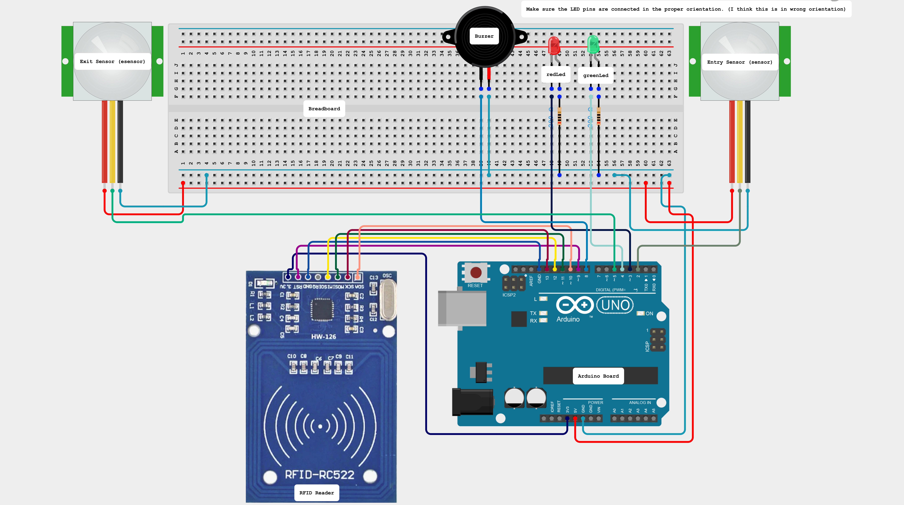

# Smart Attendance System

Proxy-resistant attendance logging with RFID and two PIR sensors. A student is marked only when the system sees them physically pass through the doorway, not just tap a card. A face-recognition prototype explores a camera-based alternative.


> Showcased at the **ECE Department Expo, PSG iTech**.

---

## The Problem

Card-based attendance is easy to game. One student can tap a friend's card, or tap in and walk away. Here a card tap counts only when it sits inside a valid **entry → tap → exit** sequence detected by two motion sensors on either side of the reader.

## How It Works

<p align="center"></p>

**Entering**
1. The **entry PIR** detects a person and the buzzer chirps.
2. The person taps their **RFID card**.
3. The **exit PIR** confirms they walked through, and the record is logged as `Name,Roll,Entry`.
4. If the exit sensor fires *without* a card tap, the buzzer double-beeps and the person must step back and wait 5 seconds.

**Leaving** follows the same sequence in reverse and is logged as an exit. A mismatch between the number of entries and exits flags someone who skipped the process, which shows up in later analysis.

Records are streamed over serial (9600 baud) into Excel with the **Data Streamer** add-in.

## Hardware

| Component | Arduino pin |
|---|---|
| MFRC522 RFID reader | SPI: SS → D10, RST → D9, MOSI/MISO/SCK → D11/D12/D13 |
| PIR sensor (entry) | D2 |
| PIR sensor (exit) | D5 |
| Red / green LED | D3 / D4 |
| Buzzer | D8 |

## Face Recognition Prototype

[`face_recognition/`](face_recognition) is an OpenCV prototype that identifies students from a webcam instead of a card:

| Script | Purpose |
|---|---|
| `access.py` | Webcam sanity check |
| `identification.py` | Haar-cascade face detection |
| `trainer.py` | Trains an LBPH recogniser from `image_data/<name>/` and writes `trainner.yml` and `labels.pickle` |
| `recognise.py` | Live recognition with name overlay |

## Repository Structure

```
.
├── firmware/attendance/     Arduino sketch (RFID + dual PIR state machine)
├── face_recognition/        OpenCV LBPH face-recognition prototype
│   └── image_data/          Training images, one folder per person
├── hardware/                Wiring diagram (PNG + circuit file)
└── docs/                    Report, presentation and expo template
```

## Getting Started

### Firmware
1. In the Arduino IDE, install the **MFRC522** and **Time** libraries from the Library Manager.
2. Wire the circuit as shown above.
3. Register card UIDs in `firmware/attendance/attendance.ino` (`Student1`, `Student2`, …).
4. Upload to an Arduino UNO.
5. In Excel, open **Data Streamer**, connect the board's COM port and start recording.

### Face recognition
```sh
pip install opencv-contrib-python pillow numpy
cd face_recognition
python trainer.py      # build the model from image_data/
python recognise.py    # press q to quit
```

## References

- [MFRC522 RFID with Arduino](https://www.youtube.com/watch?v=Gtu-kZ24O0o)
- [PIR motion sensor basics](https://youtu.be/FxaTDvs34mM)
- [Excel Data Streamer](https://www.youtube.com/watch?v=dcRQH1zPNbA)

## License

Released under the [GPL-3.0 License](LICENSE).

## Contact

**Dousik Manokaran**: [m.dousik@gmail.com](mailto:m.dousik@gmail.com) · [LinkedIn](https://www.linkedin.com/in/dousikmanokaran/)
